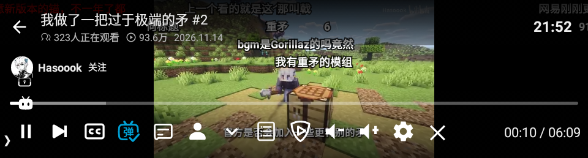

# blbl-pen · 点读笔专用版

一个面向 **小屏 / 点读笔 / 低配安卓设备** 的第三方哔哩哔哩安卓客户端。

本项目是 [cat3399/blbl](https://github.com/cat3399/blbl) 的二次开发分支（fork），只针对"屏幕小、DPI 算得离谱、没有音量键"的机型做适配，**保留原项目的全部功能、代码与作者署名**。

- 上游原作者：[cat3399](https://github.com/cat3399/blbl)（项目地址、作者信息、致谢、免责声明全部保留）
- 本分支作者：[Satellite18111](https://github.com/Satellite18111)
- 本分支仓库：https://github.com/Satellite18111/blbl-pen

App 内"设置 → 关于应用"同时展示两条地址：`项目地址（原作者）` 与 `点读笔专用版地址`。

## 下载

最新安装包在 [发行版](https://github.com/Satellite18111/blbl-pen/releases/latest)：

- `Blbl-0.1.29-pen11.apk`（5.0 MB，release 签名，Android 6.0 / armeabi-v7a 可直接安装）
- 从上游原版换过来需先卸载；同一签名的新版可覆盖安装

## 界面预览

点读笔 A20Pro（258×960，安卓6.0）实拍：

**首页（密度修正后，4 列可点可读）**


**播放页（音量加减键位于齿轮按钮左侧）**


上游原项目的界面预览见 [`docs/UPSTREAM_README.md`](./docs/UPSTREAM_README.md)。

## 这个分支解决了什么

原版假定屏幕短边至少 720px，密度按"1920×1080@1.5 倍"推算：`density = 1.5 × (短边px / 1080)`。在短边 258px 的点读笔上算出密度≈0.358，整个界面缩到三分之一——首页一屏 5 列、每卡约 50px，字看不清也点不准，播放页控制条按钮同样难点。

本分支在**不动上游默认行为**的前提下加了小屏兜底：

| 改动 | 说明 |
| --- | --- |
| 小屏密度下限 | 短边 < 720px 时密度取 `max(原算法值, 1.0)`，即 1dp = 1px，字号与按钮恢复正常可读尺寸 |
| 播放页音量键 | 控制栏新增音量减/加按钮（点读笔没有音量键），位置在设置（齿轮）按钮左侧，点击 ±1 级、长按连发 |
| 播放页触摸转发 | 原版最上层是全屏 `touch_gesture_layer`，会吞掉控制栏所有点击；现改为手势层按真实按钮位置识别落点，命中音量键区域时转发给音量键，其余区域行为不变（点一下显示/隐藏控制栏） |
| 控制栏超时 | 4 秒 → 8 秒，小屏手动点按更从容 |
| release 精简包 | 走 R8 + 资源压缩，体积 14.5MB → 5.25MB，方便 `/data` 只剩几十 MB 的老设备安装 |
| 项目地址入口 | 设置页新增"点读笔专用版地址"，原作者"项目地址"原样保留 |

改动细节（逐文件说明）见 [`docs/pen-changes.md`](./docs/pen-changes.md)。

## 功能概览

- 侧边栏导航：搜索 / 推荐 / 分类 / 动态 / 直播 / 我的
- 扫码登录入口
- 视频播放：Media3(ExoPlayer)，支持分辨率/编码/倍速/字幕/弹幕等设置
- 设置页：播放与弹幕偏好、点读笔专用版地址入口等

## 技术栈

- Kotlin + AndroidX + ViewBinding
- Media3(ExoPlayer)/[Ijkplayer](https://github.com/cat3399/ijkplayer)
- OkHttp
- Protobuf-lite
- Material / RecyclerView / ViewPager2

## 构建

环境要求：JDK 17+（本项目在 JDK 21 上验证），Android SDK。

调试包：

```
./gradlew assembleDebug
```

发布包（已开启 R8 混淆 + 资源压缩）：

```
./gradlew assembleRelease
```

可选版本参数：

```
./gradlew assembleRelease -PversionName=0.1.29-pen9 -PversionCode=38
```

### 本分支实际使用的构建参数

`compileSdk` 按本机 SDK 兼容到 37，并显式指定 `buildToolsVersion = "36.0.0"`。若你的机器只有 Android 36 平台，把 `app/build.gradle.kts` 与 `gradle.properties` 里的 37 改回 36 即可。

release 包需要签名参数（`gradle.properties` 或命令行）：

```
-PRELEASE_STORE_PASSWORD=... -PRELEASE_KEY_ALIAS=... -PRELEASE_KEY_PASSWORD=...
```

密钥文件放在 `keystore/release.keystore`，**已被 `.gitignore` 排除，仓库不含任何私钥**。更换签名后再安装需先卸载旧包（会清掉登录状态与设置）。

若本机 SDK 平台版本与 AGP 校验冲突，可跳过 AAR 元数据校验与 release lint：

```
./gradlew assembleRelease -x :app:checkReleaseAarMetadata -x :app:lintVitalRelease -x :app:lintVitalReportRelease
```

## 已验证设备

| 设备 | 系统 | ABI | 分辨率 | 结果 |
| --- | --- | --- | --- | --- |
| 点读笔 A20Pro（sc7731） | Android 6.0 / SDK 23 | armeabi-v7a | 258×960 @160dpi | 首页 4 列可读；播放页满屏；音量键实测可加可减 |
| 小米平板 / Alldocube iPlay_30 | Android 11+ | arm64-v8a | 平板 | 小屏逻辑仅在短边 <720px 生效，平板不受影响 |

上游原版需要 `minSdk 26` 与 `arm64-v8a`，点读笔装不上；本分支保持上游 `minSdk 21`、无 native so 依赖，因此 armeabi-v7a 老设备可直接安装。

## 联系方式

- 本分支（点读笔适配）的问题：到 [Issues](https://github.com/Satellite18111/blbl-pen/issues) 提，或在本仓库下留言

## 与上游保持同步

```bash
git remote add upstream https://github.com/cat3399/blbl.git
git fetch upstream
git merge upstream/main
```

小屏适配集中在 `UiDensity.kt`、`UiScale.kt` 与 `PlayerActivityTouch.kt`，冲突面很小。

## 感谢

- https://github.com/cat3399/blbl 上游原作者，本项目的全部基础功能与界面设计来自该项目
- https://github.com/SocialSisterYi/bilibili-API-collect B站API收集整理
- https://github.com/xiaye13579/BBLL 优秀的页面设计和操作逻辑，本项目绝大部分页面和操作逻辑都是抄袭BBLL🥰
- https://github.com/bggRGjQaUbCoE/PiliPlus 部分关键功能参考了Piliplus的逻辑
- https://github.com/debugly/ijkplayer 感谢debugly大佬移植的ijkplayer
- 开源第三方B站客户端
- 群友们的详细测试与反馈

## 免责声明

> 不得利用本项目进行任何非法活动。 不得干扰B站的正常运营。 不得传播恶意软件或病毒。 此外，为降低法律风险

1. 🚫禁止在官方平台（b站）及官方账号区域（如b站微博评论区）宣传本项目
2. 🚫禁止在微信公众号平台宣传本项目
3. 🚫禁止利用本项目牟利，本项目无任何盈利行为，第三方盈利与本项目无关

上游 README 原话：代码都是codex写的，如有问题请联系https://openai.com/ 😤

本分支的点读笔适配改动同样遵循上游许可与免责声明；如上游作者对本分支有异议，请提 issue，我会立即调整或下架。

## 作者声明
本项目及本页由豆包老师开发和撰写（除了这条），作者仅提供灵感。
